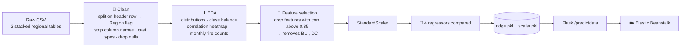

<div align="center">

# 🔥 FireWatch

### Predicting the Fire Weather Index for Algerian forests, from EDA to a deployed Flask API

*Nine weather readings in, a wildfire-risk score out. Ridge regression with **R² = 0.984**, served on AWS Elastic Beanstalk.*

<br/>


</div>

---

## 💡 The problem

The **Fire Weather Index (FWI)** is the standard measure of wildfire danger. This project predicts FWI from daily weather and fuel-moisture readings, using the **Algerian Forest Fires dataset**: 244 days from June to September 2012 in two regions, **Bejaia** (north-east) and **Sidi-Bel Abbes** (north-west).

---

## 🔬 Pipeline



**Data cleaning highlights**
- The raw file has **two regional tables stacked together**. The split row becomes a binary **`Region`** feature.
- Column names have stray whitespace (`' RH'`, `'Classes  '`), and the `Classes` labels are inconsistent (`'fire'`, `'fire   '`, `'not fire  '`…). Both are normalised before encoding.

**EDA finding:** **August and September** have the most fires in both regions.

---

## 📈 Results

Test set is 25% of rows (`random_state=42`). All models were trained on standardised features after the correlation filter.

| Model | MAE ↓ | R² ↑ |
|---|---:|---:|
| Linear Regression | 0.547 | 0.9848 |
| **Ridge** ✅ *(deployed)* | **0.564** | **0.9843** |
| Lasso | 1.133 | 0.9492 |
| ElasticNet | 1.882 | 0.8753 |

Ridge matches plain linear regression on accuracy. It was chosen because the **L2 regularisation** makes it more robust to the remaining correlated fire-weather features.

---

## 🌐 Inference API

`app.py` loads `models/ridge.pkl` and `models/scaler.pkl` once at startup.

| Route | Method | Purpose |
|---|---|---|
| `/` | GET | Landing page |
| `/predictdata` | GET | Input form |
| `/predictdata` | POST | Takes `Temperature, RH, Ws, Rain, FFMC, DMC, ISI, Classes, Region`, scales them, and returns the predicted FWI |

```bash
git clone https://github.com/nishantrv/Algerian-Forest-Fire-Deployment-with-AWS-BeanStalk.git
cd Algerian-Forest-Fire-Deployment-with-AWS-BeanStalk
pip install -r requirements.txt
python app.py        # → http://localhost:5000/predictdata
```

---

## ☁️ Deploying to AWS Elastic Beanstalk

The EB Python platform looks for a WSGI callable. Add `.ebextensions/python.config`:

```yaml
option_settings:
  "aws:elasticbeanstalk:container:python":
    WSGIPath: app:app
```

Then deploy:

```bash
eb init -p python-3.11 firewatch
eb create firewatch-env
eb open
```

---

## 🗂️ Layout

```
notebooks/2_0_EDA_And_FE_Algerian_Forest_Fires_.ipynb   cleaning + EDA
notebooks/3_0_Model_Training.ipynb                      feature selection + 4 models
datasets/Algerian_forest_fires_cleaned_dataset.csv
models/ridge.pkl · models/scaler.pkl
app.py · templates/
```

---

<div align="center">

Built by **[Nishant](https://github.com/nishantrv)**. If this was useful, a ⭐ is appreciated.

</div>
